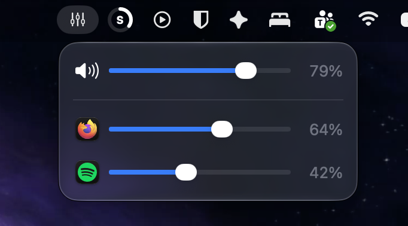

# Sound Mixer

A lightweight menu-bar app for macOS that gives you a per-app volume mixer, plus control of the system output volume, all in one small panel.

## Installation

1. Download the app's `.zip` file from the **Releases** page of this repository.
2. Unzip the downloaded archive to get `macOS-mixer.app`.
3. Move `macOS-mixer.app` into your **Applications** folder.
4. Open the app from Applications. It appears in the menu bar as a sliders icon (no Dock icon window).
5. When prompted, allow audio access. If an app's volume can't be controlled, go to **System Settings › Privacy & Security › Screen & System Audio Recording** and enable Sound Mixer.

## Features

### Menu-bar panel
- Lives in the menu bar; click the sliders icon to open the mixer panel.
- Right-click the icon for a menu with **Launch at startup** and **Quit**.

### System volume (master) row
- Controls the volume of the current default output device, just like the macOS volume HUD.
- Hover the speaker icon to see the name of the output device.
- Click the speaker icon to mute / unmute the system output. A diagonal slash is drawn across the icon while muted.
- Moving the slider above zero automatically unmutes the system.
- Reacts instantly to changes made with your keyboard volume keys, and to switching the default output device.
- Disabled automatically for outputs that have no system volume control (some HDMI outputs).

### Per-app volume
- Every app that is currently playing sound gets its own row with the app's icon, name and volume controls.
- Apps are listed alphabetically.
- Helper processes (for example browser renderers) are grouped under their parent app, so each app has a single row.
- Command-line tools that play audio are listed too, and the mixer never lists itself.
- Apps whose volume or mute you have changed stay in the list while paused, so you can adjust them before they play again.
- Shows "No apps playing sounds." when nothing is playing.
- Hover an app's icon to see its name in a tooltip, even when the panel isn't the key window. The tooltip disappears when you click the icon.
- Volume changes are smoothly ramped to avoid clicks and zipper noise, and audio taps are kept alive while an app runs to avoid pops.

### Controls on every row
- **Slider** from 0% to 100%.
- **Clickable icon**: click an app's icon (or the speaker icon on the system row) to mute / unmute it. A diagonal slash appears across the icon when it is muted or the volume is 0%.
- **Percentage field**: click the percentage to type an exact value (changes apply live as you type).
  - Up / Down arrow keys nudge the value by 1%.
  - Return or clicking elsewhere confirms; Escape cancels and restores the previous volume.
- **Scroll wheel / trackpad**: scroll over a slider or percentage to adjust in 1% steps (scrolling down or left raises the volume).

### Smart relationship with the system volume
- No app can be louder than the system slider. Lowering the system volume lowers the apps' sliders by the same amount, and they come back up with it, never above the level you set.
- An app at X% plays as loud as the system slider would at X%, regardless of where the system slider currently is.
- Learns your output device's volume curve (per device) and becomes more accurate as you use the system slider.
- While the system is muted, every app appears muted and can't be changed (the rows aren't dimmed, they just ignore clicks and scrolling); each app's own volume and mute state are preserved and restored when you unmute.

### Output devices
- Follows the default output device and rebuilds audio routing automatically when the device changes.
- Keeps separate volume curves for each output device.

### Launch at startup
- Launches at login by default (registered on first run).
- Toggle it any time from the right-click menu on the menu-bar icon. If macOS needs approval, it is treated as enabled and awaits your OK in System Settings.

### Accessibility
- Sliders, mute icons and percentage fields have VoiceOver labels and hints.

### Error reporting
- If an app's audio can't be controlled, a message in red explains why and points to the required privacy permission.

## Requirements

- macOS version with Core Audio process taps (macOS 14.2 or later).
- Audio recording permission for system audio.

## Quitting

Right-click the menu-bar icon and choose **Quit**. Apps return to normal playback when the mixer stops.
